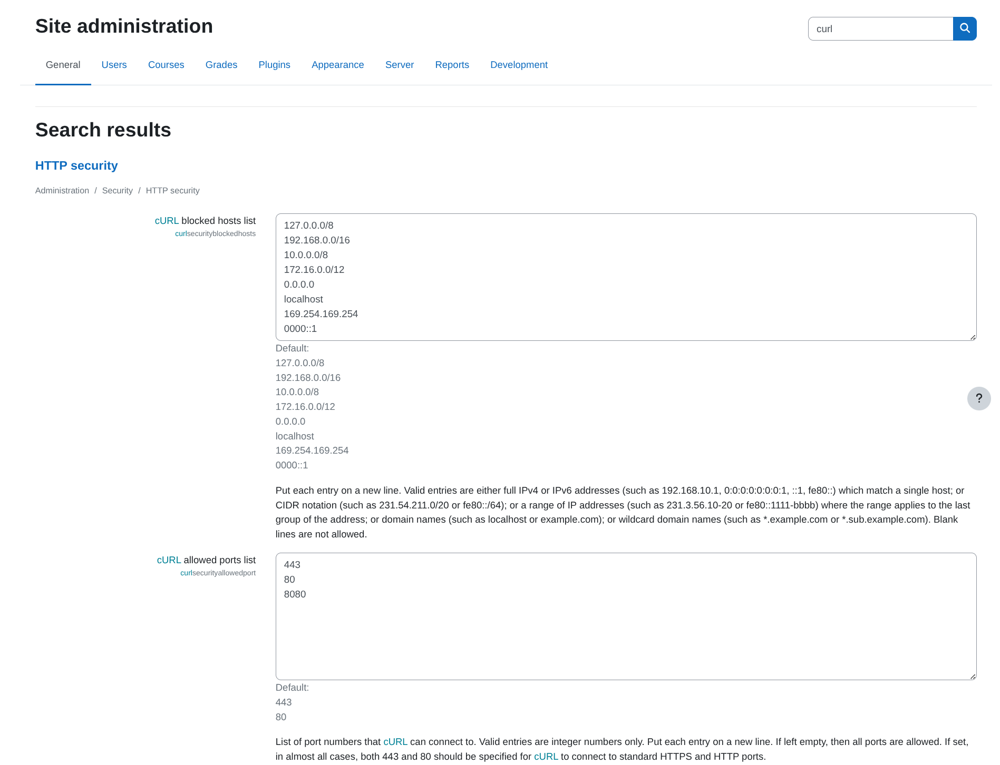
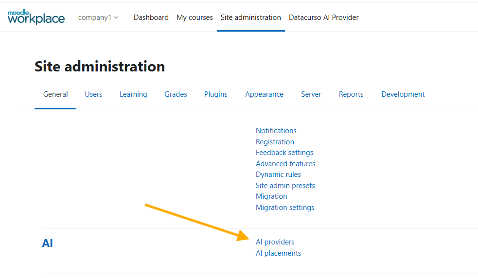
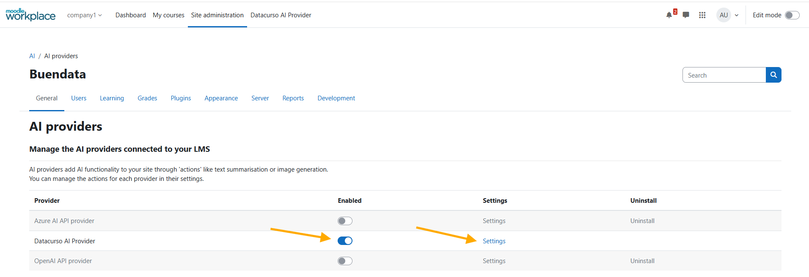
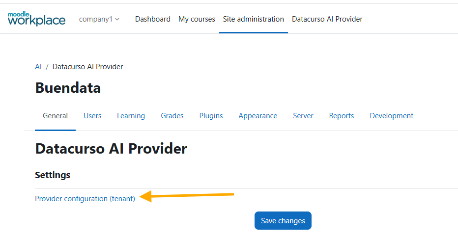
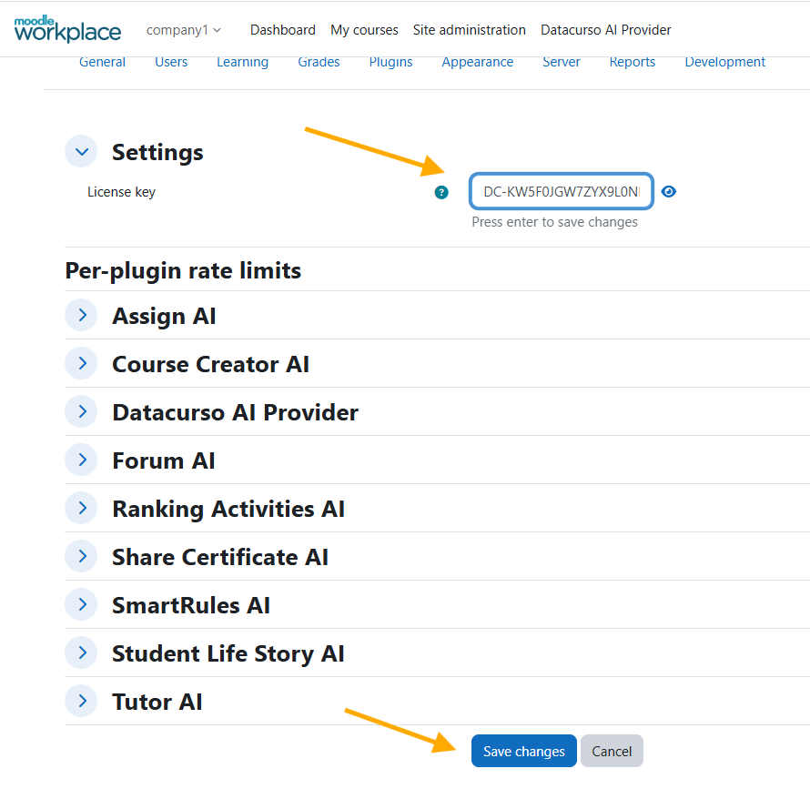
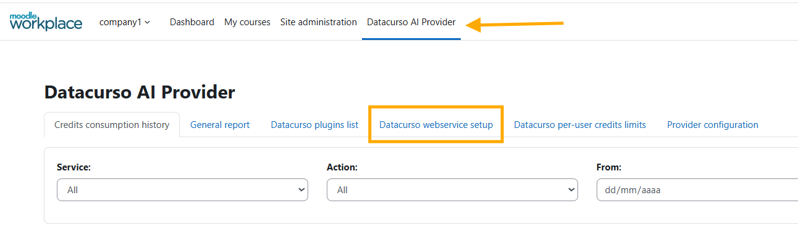
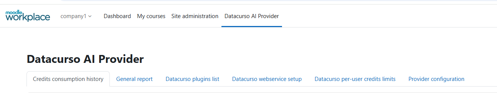
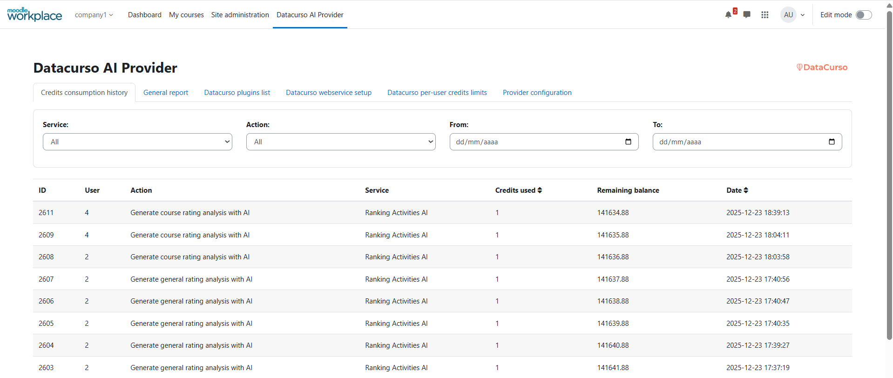
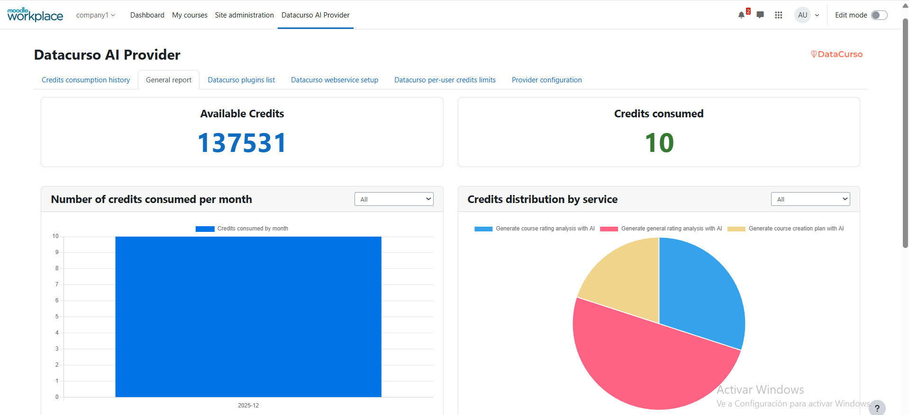
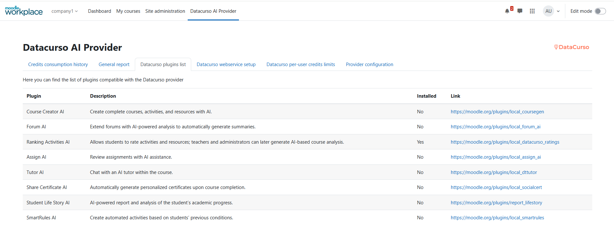

# Datacurso AI Provider for Moodle Workplace 4.5

The **Datacurso AI Provider** is the core engine that connects Moodle with the **Datacurso AI services** — unlocking a full ecosystem of smart, AI-powered plugins designed to revolutionize online learning.

This provider serves as the central bridge that powers every Datacurso AI extension, enabling a new generation of intelligent features for teachers, students, and administrators.

In addition, the **Datacurso AI Provider** includes built-in capabilities to display **detailed AI credit usage reports** directly within Moodle.  
Administrators can easily monitor and manage AI service consumption through visual dashboards showing:

- **Number of credits consumed per month**
- **Available credits**
- **Total credits consumed**
- **Credit distribution by service**
- **Daily credit usage trends**

## The Datacurso AI Plugin Suite

Transform Moodle into a **smarter, faster, and more engaging learning platform** with the **Datacurso AI Plugin Suite** — a collection of next-generation tools that bring artificial intelligence directly into your LMS.  
All plugins in this suite are powered by the **Datacurso AI Provider**.

### Explore the Suite

- **[Ranking Activities AI](https://moodle.org/plugins/local_datacurso_ratings)**
  Empower students to rate course activities while AI analyzes feedback and provides deep insights to educators.

- **[Forum AI](https://moodle.org/plugins/local_forum_ai)**  
  Introduce an AI assistant into your forums that contributes to discussions and keeps engagement alive.

- **[Assign AI](https://moodle.org/plugins/local_assign_ai)**  
  Let AI review student submissions, suggest feedback, and support teachers in the grading process.

- **[Share Certificate AI](https://moodle.org/plugins/local_socialcert)**  
  Celebrate achievements automatically! AI generates personalized social media posts when students earn certificates.

- **[Student Life Story AI](https://moodle.org/plugins/report_lifestory)**  
  Gain a complete view of student performance with AI-generated summaries across all enrolled courses.

- **[Course Creation AI](https://moodle.org/plugins/local_coursegen)**  
  Build full Moodle courses in minutes — complete with lessons, activities, and resources — guided by AI.

## Powering Moodle’s Built-In AI Features

Beyond the Datacurso suite, the **AI Provider** also enables Moodle’s **native AI features**, enhancing creativity and productivity across your entire platform:

- **Generate Text** – Create meaningful content from any prompt.  
- **Generate Image** – Produce original images from text descriptions.  
- **Summarize Text** – Quickly generate concise summaries from course content.

## Pre-requisites

1. Tener minimo la version 4.5 de moodle
2. Adquirir un paquete de creditos de AI desde el [shop de DataCurso](https://shop.datacurso.com/index.php?m=tokens_manager) y crear una llave de licencia tal como se indica en la seccion [Obtener llaves de licencia](#obtener-llaves-de-licencia)

## Installing via uploaded ZIP file

1. Log in to your Moodle site as an admin and go to `Site administration > Plugins > Install plugins`.
2. Upload the ZIP file with the plugin code. You should only be prompted to add
   extra details if your plugin type is not automatically detected.
3. Check the plugin validation report and finish the installation.

## Installing manually

The plugin can be also installed by putting the contents of this directory to

```
{your/moodle/dirroot}/ai/provider/datacurso
```

Afterwards, log in to your Moodle site as an admin and go to `Site administration > Notifications` to complete the installation.

Alternatively, you can run

```bash
php admin/cli/upgrade.php
```

to complete the installation from the command line.

## Testing locally (cURL settings)

If you plan to test from a local environment, adjust Moodle’s cURL security settings so the provider and its dependent plugins can make HTTP requests:

1. In the site administration search box, type "curl" and open the page that shows cURL/HTTP security settings.
2. In the first field `cURL blocked hosts list`, remove any registered IP addresses or host entries.
3. In the second field `cURL allowed ports list`, add the port where your local Moodle is running (for example: `8000`).

These Moodle security settings directly affect the Datacurso AI Provider and, therefore, the functionality of any plugins that depend on it.



## Getting license keys

1. Sign in or create an account on the [shop DataCurso](https://shop.datacurso.com)
2. Go to the **Manage AI Credits** section
   
   

3. Click on the **BUY MORE CREDITS** button
   
   
   
4. Select the package of credits you want to acquire
   
   

5. Once the credits are acquired, the new balance will be displayed
   
   

6. To create a license key, we enter the **My Licenses** section and click the **Create License** button
   
   

7. In the confirmation window that appears, click the **Create** button
   
   
   
8. Once the license key is created, we can assign credits to use it in moodle. Click the **Assign Credits** button

   

9.  In the confirmation window that appears, enter the amount of credits you want to assign to the license key and click the **Confirm Assignment** button
   

10. Once the credits are assigned, we can copy the license key to use it in moodle as indicated in the [Plugin Configuration](#plugin-configuration) section
    
    

**Note:** We can create several license keys and assign different amounts of credits to use them in different moodle sites.

## Plugin Configuration

1. Log in to your Moodle site as an admin and go to `Site administration > General > AI > AI Providers`.
   
   

2. Enable the **Datacurso AI Provider** and click on **Settings**

   

3. Enter the following settings:

   - **Link configuration provider of tenant**: Enter the link configuration tenant

   

4. Configure the settings:

   - **License key**: Enter the license key that we copied in the [Obtain License Keys](#obtain-license-keys) section

   

### ⚠️IMPORTANT: 

This configuration only applies to the tenant in which it is configured. In this example, this provider configuration is applied and saved only in the Company1 tenant.


## Datacurso AI Provider 

In this section we will find global reports and configurations from our provider.



## Actions

From the same configuration page of the **Datacurso AI Provider**, you can enable and customize the following Moodle AI-powered actions, seamlessly integrated with Moodle’s native capabilities:

- **Generate Text** – Create meaningful content from any prompt.  
- **Generate Image** – Produce original images from text descriptions.  
- **Summarize Text** – Quickly generate concise summaries from course content.


> **Image delivery contract.** The AI service returns generated images inline (`b64_json`). If it returns an image URL instead, the plugin only downloads it over `https` from the same host as the AI service endpoint, with a `png`/`jpg`/`jpeg`/`webp` extension, without following redirects and up to 10 MiB; images hosted on a third-party CDN are rejected by design.

## Reports Datacurso AI Provider

In this section you can monitor credit usage in detail for each action performed in each plugin of the Datacurso suite, including totals, trends, and distribution by service.

To view the reports, go to `Site administration > Reports > General report Datacurso AI`.



### History Consumption Credits 

Here we can see three sections. The first section shows the credit consumption history for AI usage in plugins that use the Datacurso provider, as well as the predefined AI actions in Moodle.



### Reports grafics

The second section displays information about credit usage through visual graphs.




### Datacurso List Plugins

The third section shows the list of Datacurso plugins that are compatible with the Datacurso AI provider.



## Privacy and audit

### Audit log of external requests

Every request the plugin sends to a Datacurso service is recorded in the Moodle log as the event
`\aiprovider_datacurso\event\external_request_completed`: requests of the AI services and course service clients
(including uploads and downloads), of the shop client, and of the core AI actions (text, summary, image and the image
download). Each event records the user, the context, the client, the service, the HTTP method, the endpoint path without
its query string, the result (`success`, `failure`, or `refused` when nothing left the site, for example when the service
URL is not HTTPS or the request has no license key), the HTTP status and, on failure, an error code.

The event never records the license key, the headers, the payload or prompt, file names, the response body, the site URL,
the user pseudonym or the transport error text. Path segments that identify a record or a session (numbers, UUIDs, long
hexadecimal strings and long tokens mixing letters and digits) are logged as `{id}`. It is logged in the system context
unless the plugin making the request passes its own with `set_audit_context()` on the client. Logging never breaks a
request.

Only requests sent by the Moodle server are logged. The streams that a browser opens directly to a service, such as the
chat stream whose URL `ai_services_api::get_streaming_url_for_session()` builds, do not pass through the server and are
not in the log.

### Transport security

Every request to a Datacurso service travels over HTTPS with the certificate chain and the host name verified. A
redirect answer is never followed, because it would hand the license key and the content to another host: the request
fails instead. Requests to the AI services give up after 300 seconds, file downloads after 300 seconds and requests to
the shop after 30 seconds; opening the connection may take up to 30 seconds.

Developers who run the services locally over plain HTTP can allow it by adding this line to `config.php`:

```php
$CFG->aiprovider_datacurso_allow_insecure_transport = true;
```

It only allows the `http` scheme; certificates are still verified on HTTPS and redirects are still refused. Never set it
on a production site.

### What the services receive about the site and the user

The requests of the AI services and course service clients carry `site_id`, `site_url`, `userid`, `lang` and
`tenant_id`. The course service also receives the user's `timezone`; the AI services receive it only on the CV and job
matching routes, which use it.

### How the user pseudonym is computed

The `userid` sent to the services is never the Moodle user id. It is computed in
`classes/local/outbound_privacy.php` as an HMAC-SHA256 of the user id, keyed with a secret of 32 random bytes generated
once per site and stored in the plugin configuration, truncated to 32 hexadecimal characters. The secret is never sent to
any service and is not the `site_id`, so the services cannot recover the user id from the pseudonym, and pseudonyms of
the same person on different sites cannot be matched.

Updating from a release that sent the Moodle user id gives each user a new identifier at the services. The per-user
consumption counters and rate-limit windows start again (the totals of the licence are kept), the consumption recorded
under the old identifier stays in the shop history without a user, and the data the course service stored under the old
identifier is not reached by the Moodle data erasure and export requests.

### Deletion of user data

When a Moodle user is deleted, the consumption records of that user already copied to the local history are unlinked
from the account (they are attributed to nobody and stay in the totals of the site), and the pseudonym of that user is
removed from the local cache, so records synchronised later are not linked to the account either. The course service is the only Datacurso service that stores
data per user (generation requests with the pseudonym, consumption and the conversation state). It offers an erase
operation by site, pseudonym and plugin, which the plugins that send it data invoke from their Privacy API; Smart Rules AI
(`local_coursedynamicrules`) keeps a record of each request until the service confirms the erasure and retries until it
does. The other services do not store the data they receive.

### What the token manager service keeps per user

The token manager service, which applies the per-user consumption limits and reports consumption to the shop, keeps one
record (in its MongoDB collection `ratelimit`) per license key, site, user pseudonym and service, with the start of the current window, the credits used in it
and the time of the last update. Records are written only while a consumption limit is enabled for the service, and they
are kept while the license exists. For each request it forwards the user pseudonym, the action,
the service, the credits and the cost detail to the consumption API of the shop.

### Retention and location

- The request logs of the services are ephemeral: they are deleted every time the services are updated.
- Token consumption is kept while the license exists.
- The assignment grading service processes submissions in memory and does not store them.
- The language models are used in paid mode (Gemini API): the model provider does not use the data for training and
  keeps logs for about 55 days for abuse detection and legal compliance.
- The services for the European Union are hosted in Frankfurt (AWS `eu-central-1`).

## License ##

2025 Data Curso LLC <https://datacurso.com>

This program is free software: you can redistribute it and/or modify it under
the terms of the GNU General Public License as published by the Free Software
Foundation, either version 3 of the License, or (at your option) any later
version.

This program is distributed in the hope that it will be useful, but WITHOUT ANY
WARRANTY; without even the implied warranty of MERCHANTABILITY or FITNESS FOR A
PARTICULAR PURPOSE.  See the GNU General Public License for more details.

You should have received a copy of the GNU General Public License along with
this program.  If not, see <https://www.gnu.org/licenses/>.
